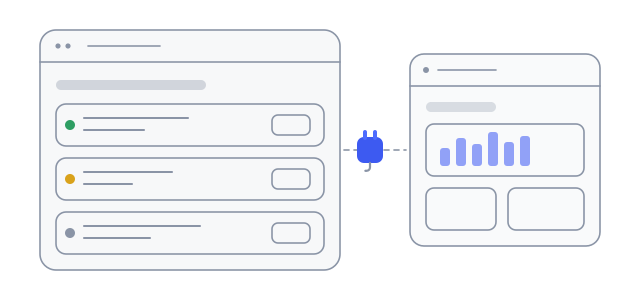

# MCP-подключения (форк dsh-plugin-mcp-apps)

Форк `dsh-plugin-mcp-apps@0.5.7` с модульной локализацией: русский, английский и китайский интерфейс, язык следует переключателю DSH.

```bash
dsh plugin --profile desktop add https://github.com/Vertudo/dsh-plugin-mcp-apps
```

Из локального чекаута вместо адреса передаётся `link:<путь к чекауту>`; через `plugin_manager` — тот же аргумент.

## Интерфейс



Панель собрана на публичных токенах темы DSH, поэтому следует светлой и тёмной теме, теме оформления и размеру шрифта:

- шапка показывает сводку: сколько подключений, сколько активно, сколько инструментов и сколько с ошибкой;
- карточка — точка состояния, транспорт, число инструментов, состояние OAuth, адрес с кнопкой копирования и переключатель «отдавать инструменты модели»; «Изменить», «Проверить» и «Переподключить» стоят рядом, удаление и сброс авторизации — в меню «…»;
- редактор разбит на «Основное», «Авторизация» и «Дополнительно», кнопки закреплены внизу; «Проверить» сохраняет введённое и пробует подключиться;
- пустой список предлагает два способа начать, а пока состояние читается — показывает скелетоны.

Карточку плагина DSH собирает из `locale/<язык>.json` (`meta.title`, `meta.description`, `meta.detail`) и иконки `icon.svg`: они экспортируются как `./locale/*.json` и `./icon`. Страница деталей показывает документ из `meta.detail` — одну картинку `docs/preview.svg`.

## Локализация

Строки плагина живут в одном модуле `lib/locales.js` — по словарю на язык. Ключи задаёт `zh`: это исходные литералы апстрима, поэтому форк остаётся сравнимым с оригиналом. Остальные языки написаны против того же набора ключей.

Половин плагина две, и обе читают этот модуль:

- **браузерная** (`src/client.js`) регистрирует словари в сервисе локали DSH — `ctx.locale.register("mcp-apps", dictionaries)` — и переводит через `tr()` из `src/i18n.js`; переключение языка в настройках меняет текст на месте, без перезагрузки;
- **хостовая** (`lib/index.js`) импортирует `lib/locales.js` напрямую: сервис локали браузерный, поэтому панель сообщает свой язык в `POST /api/mcp-apps/locale`, хост запоминает его в `$DSH_HOME/mcp-apps/locale.json` и пересобирает секцию системного промпта. Страница OAuth-колбэка язык берёт из `Accept-Language` запроса.

Карточка плагина в списке — отдельная история: её читает сам DSH из `locale/<язык>.json`, и там лежит только `meta.title` и `meta.description`. Файлов сейчас три: `en`, `ru`, `zh`; `en.json` — якорь, без него DSH не читает метаданные. Поле `meta.detail` необязательно: без него страница деталей показывает README.

### Добавить язык

1. Добавить словарь в `lib/locales.js` (скопировать любой и перевести; набор ключей — как в `zh`).
2. Добавить `locale/<язык>.json` с `meta.title` и `meta.description`.
3. Прогнать `npm run check` — он падает, если ключи или подстановки `{name}` разошлись.
4. Пересобрать бандл (`npm run build`) и перезапустить DSH.

Языки, которых DSH не поставляет (например `it`), подхватываются через `ctx.locale.addLanguage` по названию из словаря. Для русского, английского и китайского этого не нужно — они встроены.

### Сборка

`lib/client.js` — артефакт, а не исходник:

```bash
npm install          # один раз: esbuild
npm run build        # src/client.js + lib/locales.js -> lib/client.js
npm run check        # паритет словарей, сборка, гейты артефакта
```

Бандл обязан оставаться одним самодостаточным файлом: браузерная таблица модулей разрешает только React и зарегистрированные пакеты, поэтому `lib/locales.js` втягивается сборкой, а не импортируется в рантайме.

## Что изменено относительно апстрима

- Интерфейс, сообщения об ошибках, страница OAuth-колбэка и блок системного промпта вынесены в словари `lib/locales.js`; в исходниках кириллических литералов нет. Китайские комментарии в коде оставлены как есть.
- `package.json`: добавлены `src`, `lib/locales.js`, скрипты сборки и проверок, `devDependency` esbuild; в `dsh.client.inject` добавлен `@deepseek-ai/dsh-client-locale`.
- Ошибки API хост отдаёт кодами (`{ok:false, error:{code, params}}`), панель переводит код своим словарём — один язык на оба конца.
- `lib/index.js`: клиент создаётся с `versionNegotiation: { mode: "auto" }` (оба места — `Connection.start()` и пробник `/test`). Умолчание SDK — `legacy`, то есть сразу `initialize`; сервер, который поддерживает только ревизию протокола `2026-07-28` (EFTR.MCP), отвечает на `initialize` ошибкой `-32601 «Неизвестная операция; поддерживается 2026-07-28»`, и подключение после OAuth падало. В режиме `auto` SDK сначала шлёт `server/discover` и откатывается к `initialize` только для легаси-серверов. Ту же опцию использует нативный `dsh-mcp-client`.
- `lib/oauth.js`, `lib/index.js`: `oauth-start` начинает поиск сервера авторизации с чистого состояния (сбрасывает `discoveryState`, `authorizationUrl`, `authorizationServerUrl`, `codeVerifier`; токены остаются) и передаёт в `auth()` адрес метаданных защищённого ресурса из 401-челленджа сервера (`protectedResourceChallenge`). Без подсказки SDK ищет `/.well-known/oauth-protected-resource` под URL подключения: если URL — голый origin, а ресурс опубликован по пути (`…/.well-known/oauth-protected-resource/mcp`), поиск получает 404 и SDK считает сервером авторизации сам origin, после чего строит несуществующий `https://host/authorize`. Кэш поиска это закреплял, поэтому одной подсказки без сброса состояния не хватало.

## Что умеет

- Панель «Подключения» в левом сайдбаре: добавить, изменить, включить/выключить и удалить любой MCP-сервер.
- Транспорты: Streamable HTTP, SSE, stdio (локальный процесс).
- Авторизация: без авторизации; параметры API в `header`/`query`/`body` (значения хранятся и маскируются); OAuth 2.0 — браузерный authorization code + PKCE, регистрация клиента автоматически (DCR), через CIMD или вручную заданными `client_id`/`client_secret`. Адрес возврата — `/api/mcp-apps/oauth/callback` на том же хосте, токен остаётся в процессе хоста.
- Импорт Claude-овского `servers.json`.
- Инструменты с ресурсом `ui://` рендерятся в рабочей области справа; выключенное подключение не отдаёт инструменты модели.
- «Переподключить» на карточке перечитывает список инструментов (`POST /api/mcp-apps/connections/<id>/refresh`); сервер, присылающий `notifications/tools/list_changed`, обновляет его сам, а оборвавшееся соединение переподключается с нарастающей паузой. Обновлённый список модель видит со следующего сообщения: снимок инструментов берётся на старте хода.

## Где лежат подключения

`$DSH_HOME/mcp-apps/connections.json`, по умолчанию `~/.dsh/mcp-apps/connections.json`, права 0600. Путь отдаёт `GET /api/mcp-apps/state` вместе с `dshHome` и `homeSource` (`core`, `env` или `default` — какое правило сработало), и показывает сама панель.

Раньше плагин писал в `/data` (на Windows — `C:\data`), то есть мимо домашнего каталога DSH: на машине оказывалось два хранилища, и панель показывала то, которое досталось её хосту. При первом запуске после правки старый файл импортируется — записи объединяются по `id`, пример `mcpstuxx` отбрасывается, исходный файл переименовывается в `connections.json.bak`, факт переноса пишется в `.legacy-store-imported`.

Нативное меню MCP (`mcp-manager`) эти подключения не видит и не перезапускает: у него свой конфиг и свои серверы.

## Ограничения

- Имя пакета совпадает с npm-версией: держать установленными обе нельзя.
- Peer-зависимость `@modelcontextprotocol/client` приходит от хоста DSH; отдельно ставить не нужно.
- Язык промпта берётся из последнего сообщения панели: пока панель ни разу не открывалась в этой установке, хост использует `en` (или `MCP_APPS_LOCALE`, если задан).
